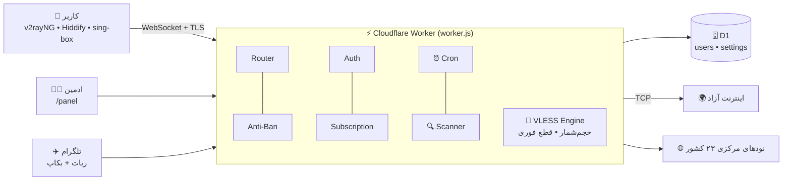

# ⚡ LML-PANEL

**پنل مدیریت کاربر و اشتراک روی Cloudflare Workers — کامل در یک فایل**

`نسخه 1.0.6` • `~21k خط کد` • `۲۳ کشور` • `بدون سرور شخصی`

---

## 🎧 توضیح صوتی (۲ دقیقه و ۳۸ ثانیه)

> 🔊 **[▶️ پخش توضیح کامل](audio/LML-PANEL-explained.mp3)** &nbsp;|&nbsp; یا بخش به بخش:
> [۱ — معرفی](audio/part1.mp3) • [۲ — پشت صحنه](audio/part2.mp3) • [۳ — قابلیت‌ها](audio/part3.mp3)

---

## 🚀 این پروژه چیه؟

یک **Worker برای Cloudflare** که داخل یک فایل `worker.js` همه‌چیز دارد: پنل وب، دیتابیس، تونل، اشتراک و ربات تلگرام.

| | |
|---|---|
| ☁️ **Serverless** | بدون VPS، روی Cloudflare Workers اجرا می‌شود |
| 🗄️ **دیتابیس** | Cloudflare D1 |
| 🔌 **تونل** | VLESS روی WebSocket |
| 🤖 **ربات** | تلگرام + بکاپ روزانه خودکار |
| 📲 **PWA** | قابل نصب روی گوشی |

## 🧭 معماری

## 🔁 مسیر کاربر

1. 👤 ادمین کاربر می‌سازد (حجم، انقضا، محدودیت آی‌پی)
2. 🗄️ اطلاعات در D1 ذخیره می‌شود
3. 🔗 لینک اشتراک ساخته می‌شود (`/sub` • `/singbox` • `/v2json`)
4. 📲 کاربر لینک را در اپ وارد می‌کند
5. 🔌 اتصال WebSocket برقرار و UUID بررسی می‌شود
6. 📊 مصرف شمرده می‌شود (ذخیره در دیتابیس هر ۲۰ ثانیه)
7. 🛑 با غیرفعال یا حذف کاربر، **همان لحظه** همه‌ی سوکت‌هایش قطع می‌شود

## 🖥️ بخش‌های پنل

| گروه | تب‌ها |
|---|---|
| 👥 **سرویس‌ها** | کانفیگ‌ها • اشتراک • کاربران آنلاین • آی‌پی‌ها • ترافیک |
| ⚙️ **سیستم** | وضعیت ورکر • دیتابیس • لاگ‌ها • بکاپ • نگهداری |

هر کاربر هم صفحه‌ی شخصی خودش را دارد (`/status/…`) با وضعیت حجم و انقضا.

## 🛰️ قابلیت‌های پایداری

- 🔐 **ECH** — تست خودکار چند Resolver و انتخاب بهترین مقدار
- 🧩 **Fragment و Noise** — پروفایل‌های آماده سبک/سنگین/خاموش
- ✨ **اسکنر آی‌پی تمیز** — تست TLS واقعی روی رنج‌های Cloudflare
- 🌍 **آی‌پی ثابت ۲۳ کشور** — با بروزرسانی خودکار
- ♻️ **ProxyIP سراسری** — هر ۱۲ ساعت تازه می‌شود

## 🛡️ حفاظت

- **Anti-Ban:** اسکنرها و بات‌های کاوشگر شناسایی و در Tarpit گیر می‌افتند
- **Rate-limit** روی ورود به پنل
- **Cron:** ریست دوره‌ای، چرخش پراکسی خراب، بکاپ روزانه به تلگرام

## 🆕 تازه‌های 1.0.6

- 🚀 بارگذاری آنی کاربران (SSR) و رفع مشکل «در حال اتصال»
- 🛑 قطع ۱۰۰٪ فوری کانفیگ‌ها با غیرفعال/حذف کاربر
- 🌍 آی‌پی ثابت ۲۳ کشور با بروزرسانی خودکار
- 🧹 پاکسازی بخش‌های قدیمی و ساده‌تر شدن فرم کاربر
- 🔕 خاموش شدن خودکار بهینه‌ساز هنگام انتخاب آی‌پی کشور

