<div align="center">



<br>

<a href="https://t.me/LML_panel"></a>
<a href="https://workers.cloudflare.com"></a>


<br><br>



</div>

<div dir="rtl">


## 𝗟𝗠𝗟 𝗣𝗔𝗡𝗘𝗟 چیست؟

**𝗟𝗠𝗟 𝗣𝗔𝗡𝗘𝗟** یک پنل مدیریت کاربر و اشتراک است که **کامل داخل یک فایل `worker.js`** نوشته شده و روی **Cloudflare Workers** اجرا می‌شود.

پنل وب، دیتابیس، تونل VLESS، ساب‌لینک، ربات تلگرام و بکاپ خودکار، همه در همین یک فایل هستند. نه سرور شخصی لازم است، نه نصب دستی.

> **یک فایل. یک ورکر. یک پنل کامل.**


<div align="center">

</div>


## مسیر ترافیک

<div align="center">

</div>

<br>

کاربر با اپ خودش (v2rayNG، Hiddify، sing-box و …) یک اتصال **WebSocket + TLS** به Worker می‌زند. Worker هدر VLESS و UUID را بررسی می‌کند و اگر کاربر فعال و حجمش باقی باشد، ترافیک را از لبه Cloudflare به اینترنت می‌رساند. وضعیت کاربران و تنظیمات در D1 نگه‌داری می‌شود.

| بخش | کار |
|:---|:---|
| **Router** | مسیریابی `/panel` و `/sub` و `/api` و `/status` |
| **Auth** | ورود به پنل با رمز و محدودیت تعداد تلاش |
| **Subscription** | ساخت ساب‌لینک و خروجی sing-box و JSON |
| **VLESS Engine** | احراز UUID، حجم‌شمار، قطع فوری سوکت‌ها |
| **Cron** | ریست دوره‌ای، چرخش پراکسی خراب، بکاپ روزانه |
| **Scanner** | اسکن آی‌پی تمیز، تست ECH و پینگ |


<div align="center">

</div>


## پنلی که همه‌چیز دارد

| گروه | تب‌ها |
|:---|:---|
| **سرویس‌ها** | کانفیگ‌ها • اشتراک • کاربران آنلاین • آی‌پی‌ها • ترافیک |
| **سیستم** | وضعیت ورکر • دیتابیس • لاگ‌ها • بکاپ و ریستور • نگهداری |
| **صفحه کاربر** | حجم مصرفی و باقی‌مانده، تاریخ انقضا، کانفیگ‌ها و QR |

پنل **PWA** است؛ یعنی می‌توانی آن را مثل یک اپلیکیشن روی گوشی نصب کنی.


## راز پایداری

هر کانفیگی که از ساب بیرون می‌آید، با این ابزارها تقویت می‌شود:

| ابزار | اثر |
|:---|:---|
| **ECH** | چند Resolver تست می‌شوند و بهترین مقدار Encrypted Client Hello در کانفیگ قرار می‌گیرد |
| **Fragment و Noise** | پروفایل‌های آماده سبک، سنگین و خاموش برای تکه‌تکه کردن TLS و نویز UDP |
| **اسکن آی‌پی تمیز** | تست TLS واقعی روی رنج‌های Cloudflare و رتبه‌بندی با گزارش جمعی کاربران |
| **ProxyIP سراسری** | هر ۱۲ ساعت خودکار تازه می‌شود و بهترین‌ها انتخاب می‌شوند |
| **بهینه‌سازی تونل** | دسته‌بندی داده آپ‌استریم، Backpressure و کش DNS و DoH |

<br>

<div align="center">

</div>


## حفاظت و خودکارسازی

یک سیستم همیشه بیدار که بدون دخالت تو کار می‌کند:

| قابلیت | چه می‌کند |
|:---|:---|
| **Anti-Ban** | اسکنرها و بات‌های کاوشگر (zgrab، shodan، masscan، curl و …) را شناسایی می‌کند و در Tarpit گیر می‌اندازد |
| **مسیرهای حساس** | درخواست به `.env` و `wp-admin` و مشابه، قبل از رسیدن به دیتابیس رد می‌شود |
| **قطع فوری** | با غیرفعال یا حذف کاربر، همه سوکت‌های فعالش همان لحظه بسته می‌شود |
| **Rate-limit** | محدودیت تلاش ورود به پنل |
| **ریست حجم** | ریست دوره‌ای خودکار |
| **چرخش پراکسی** | پراکسی خراب شناسایی و جایگزین می‌شود |
| **بکاپ روزانه** | فایل JSON کامل هر روز به تلگرام ادمین می‌رسد |
| **کش D1** | کش کوتاه‌مدت پرس‌وجوها برای سرعت بیشتر |


## نصب روی Cloudflare

<details open>
<summary><b>قدم ۱: ساخت Worker</b></summary>

<br>

در داشبورد Cloudflare به **Workers & Pages** برو و یک Worker جدید بساز.

</details>

<details open>
<summary><b>قدم ۲: ساخت دیتابیس D1</b></summary>

<br>

یک دیتابیس **D1** بساز. جدول‌ها را لازم نیست دستی بسازی؛ پنل خودش آن‌ها را می‌سازد.

</details>

<details open>
<summary><b>قدم ۳: اتصال دیتابیس</b></summary>

<br>

در تنظیمات Worker، بخش **Bindings**، دیتابیس را با این نام وصل کن:

```
DB
```

> اگر این Binding نباشد، پنل پیام «Database binding 'DB' is missing» را نشان می‌دهد.

</details>

<details open>
<summary><b>قدم ۴: قرار دادن کد</b></summary>

<br>

محتوای فایل `worker.js` را در ادیتور Worker بچسبان و **Deploy** را بزن.

</details>

<details open>
<summary><b>قدم ۵: ورود و تعیین رمز</b></summary>

<br>

آدرس Worker را باز کن و به `/panel` برو. در اولین ورود، پنل از تو می‌خواهد یک **رمز عبور** بسازی.

</details>

<details>
<summary><b>اختیاری: Cron Trigger</b></summary>

<br>

برای ریست خودکار حجم، چرخش پراکسی و بکاپ روزانه تلگرام، در بخش **Triggers** یک **Cron Trigger** اضافه کن.

</details>


## متغیرهای اختیاری

هیچ متغیری لازم نیست؛ این‌ها فقط برای قابلیت‌های اضافه‌اند.

| متغیر | کاربرد |
|:---|:---|
| `CF_API_TOKEN` و `CF_ACCOUNT_ID` | نمایش آمار مصرف Cloudflare در پنل |
| `WORKER_NAME` | نام Worker برای آمار مصرف |
| `LML_PROXYIP_FALLBACK` | ProxyIP پیش‌فرض جایگزین |

## مسیرهای اصلی

| مسیر | کاربرد |
|:---|:---|
| `/panel` | پنل ادمین |
| `/status/…` | صفحه شخصی کاربر |
| `/sub/…` | ساب‌لینک استاندارد |
| `/singbox/…` | کانفیگ sing-box |
| `/v2json/…` | خروجی JSON |
| `/api/backup` و `/api/restore` | بکاپ و ریستور |

<details>
<summary><b>تازه‌های نسخه 1.0.6</b></summary>

<br>

- بارگذاری آنی کاربران (SSR) و رفع مشکل «در حال اتصال» هنگام ورود
- قطع ۱۰۰٪ فوری کانفیگ‌ها و سوکت‌ها با غیرفعال یا حذف کاربر
- آی‌پی ثابت و زنده با بروزرسانی خودکار از سرور مرکزی
- پاکسازی بخش‌های قدیمی و ساده‌تر شدن فرم ساخت و ویرایش کاربر
- خاموش شدن خودکار بهینه‌ساز هنگام انتخاب آی‌پی کشور

</details>

<details>
<summary><b>ساختار مخزن</b></summary>

<br>

| فایل | کاربرد |
|:---|:---|
| `worker.js` | کل پنل و تونل و ربات |
| `IP LML PANEL` | لیست آی‌پی‌های ثابت کشورها |
| `assets/` | تصاویر این README |

</details>


</div>

<div align="center">

<a href="https://t.me/LML_panel"></a>

<br><br>


</div>
